# Day 3 — Sysmon + Splunk Universal Forwarder → Splunk (Kali)

**Lab:** Windows 11 VM (Sysmon, Universal Forwarder) → Kali VM (Splunk Enterprise 10.6.2.5, indexer + search head)
**Result:** Sysmon and Security events searchable in `index=win` with `EventCode`, `Image`, `CommandLine`, `ParentImage` extracted.
**Evidence tags:** `[checked]` = seen in my own screenshots/output · `[docs]` = Splunk/Microsoft documentation · `[verify]` = plausible, not yet proven in this lab.

## Data flow

```
Windows 11 VM                                         Kali VM
Sysmon driver -> Microsoft-Windows-Sysmon/Operational
Security log  -> Security
        |
Universal Forwarder (inputs.conf, index=win)  --TCP 9997-->  Splunk receiving port
                                                             index=win
                                                             props.conf + transforms.conf (search-time)
                                                             search: EventCode, Image, CommandLine
```

## Terms

| Term | Meaning | Why it matters |
|---|---|---|
| **Sysmon** | Windows system service/driver that writes detailed telemetry (process, network, file, registry, DNS) to its own event log channel. | Native Windows logs miss command lines and parent/child detail. This is what detection engineering builds on. |
| **Universal Forwarder (UF)** | Lightweight agent that reads data and ships it. No Splunk Web, minimal parsing. | Standard endpoint collection method in real environments. |
| **Receiving indexer** | Splunk instance listening (default TCP 9997) for forwarder data. | The UF needs a destination. Without one it does nothing. |
| **Deployment server** | Central Splunk instance on 8089 that pushes apps/configs to many UFs. | Not needed for one VM. Needed at fleet scale. Skipped here. |
| **Index** | Storage bucket on the indexer. Events sent to a nonexistent index are not stored `[docs]`. | Created `win` first so events had somewhere to land. |
| **Search-time extraction** | Fields extracted when you search (props/transforms), not when data is indexed. | Lets me fix field extraction later without re-ingesting data. |

---

## 1. Install Sysmon (Windows 11)

Download Sysmon from Microsoft Sysinternals, extract it, and install with the SwiftOnSecurity config (`sysmonconfig-export.xml`) from an **Administrator** PowerShell.

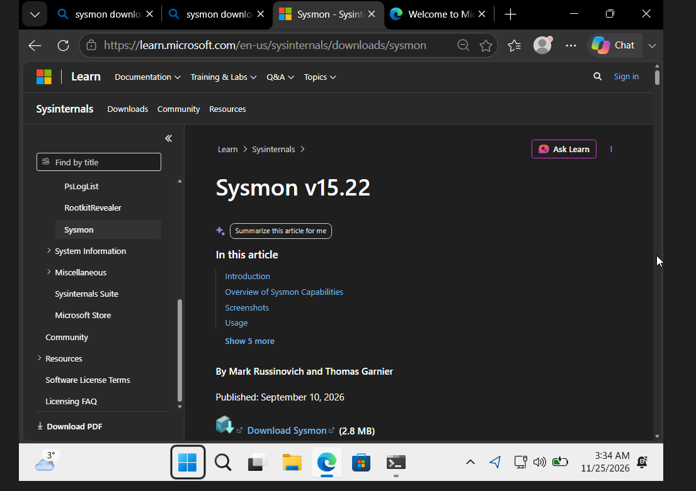
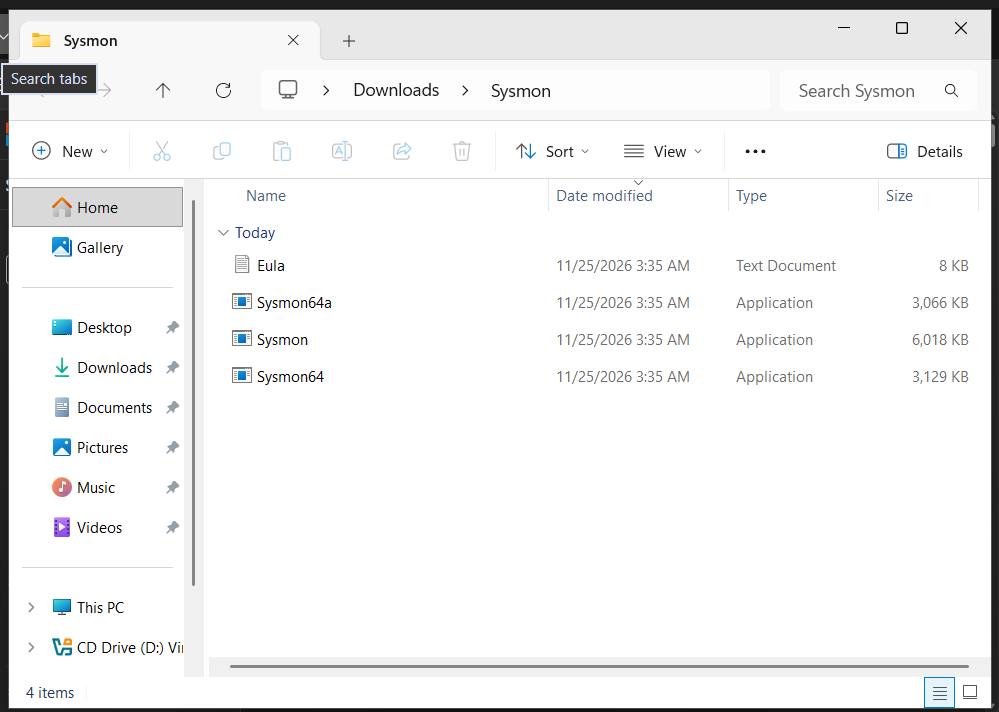

```powershell
.\Sysmon\Sysmon64.exe -accepteula -i .\sysmonconfig-export.xml
```

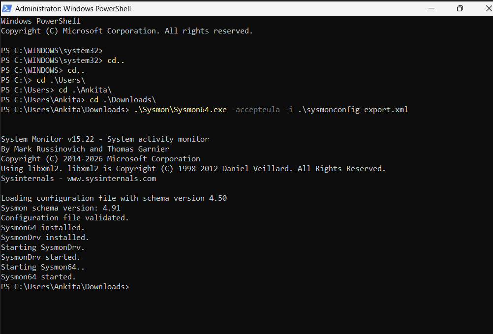

**Why the config file:** Sysmon with no config logs very little useful data. The SwiftOnSecurity config is a community baseline that keeps high-value events (process creation, network connections, DNS, registry changes) and filters common noise. It is a starting point, not a tuned production config.

**Why Sysmon64:** the 64-bit binary matches a 64-bit OS. The `Sysmon64a` binary in the folder is for ARM64.

**Verify the service and events:**

```powershell
Get-Service Sysmon64
```

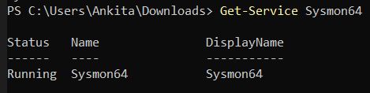

Event Viewer → Applications and Services Logs → Microsoft → Windows → Sysmon → Operational.

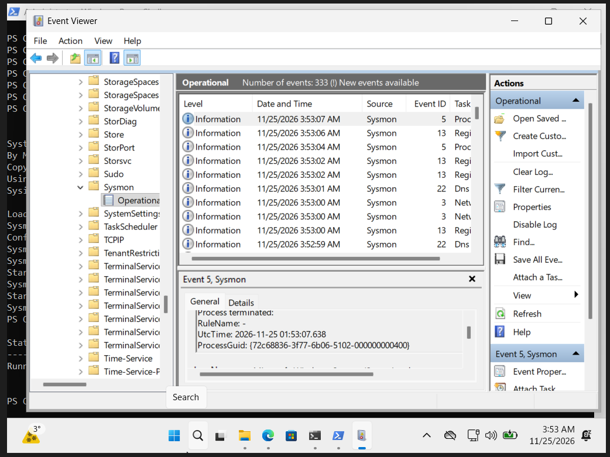

## 2. Network design between the two VMs

**Problem `[checked]`:** both VMs were on NAT. In VirtualBox each NAT adapter is private to its VM, so both received `10.0.2.15`. They cannot reach each other and the forwarder has no path to Kali.

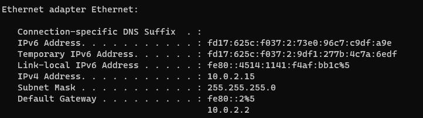
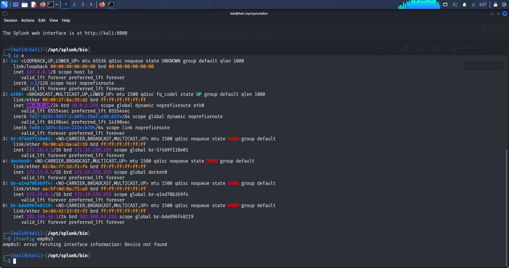

**What I did:** switched to **Bridged Adapter**. Kali got `192.168.0.107/24` and Windows could ping it.

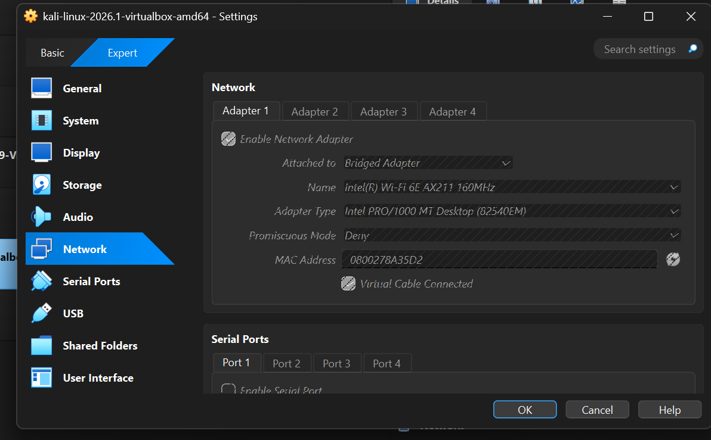
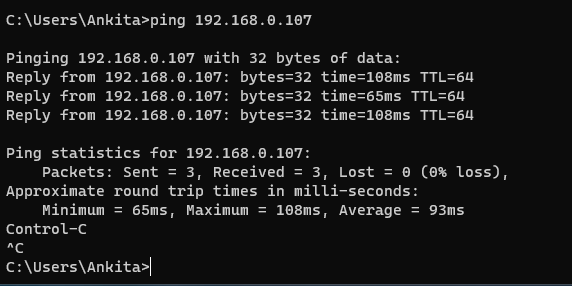
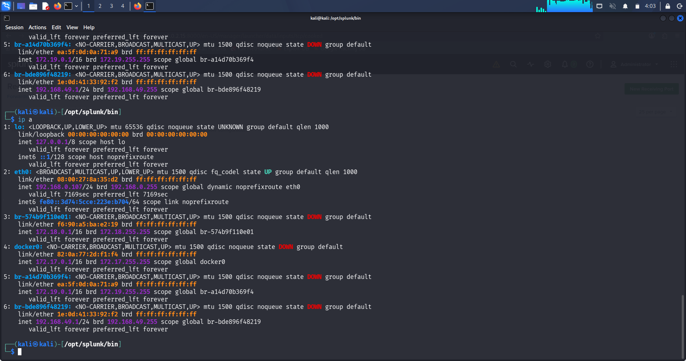

**Correction for the next rebuild:** Bridged works but is the weaker choice.
- A bridged VM sits on the home LAN beside real devices. Splunk Web on 8000 is plain HTTP (the browser shows "Not Secure"), and the VMs hold attack-tool and malware-test telemetry.
- The IP depends on the router's DHCP lease. If Kali's address changes, the forwarder's `outputs.conf` silently points at nothing.
- **Better design:** two adapters per VM. **Adapter 1 = Host-only** (e.g. `192.168.56.0/24`, VM-to-VM, not reachable from the LAN) and **Adapter 2 = NAT** (internet for downloads). Set a static address on the host-only side. This matches the lab design in the 40-day plan.
- Bridged is acceptable only for a short test on a network you trust. I should be able to explain this trade-off in an interview.

## 3. Enable receiving on Kali (Splunk Web)

Settings → Forwarding and receiving → Configure receiving → New Receiving Port → `9997`.

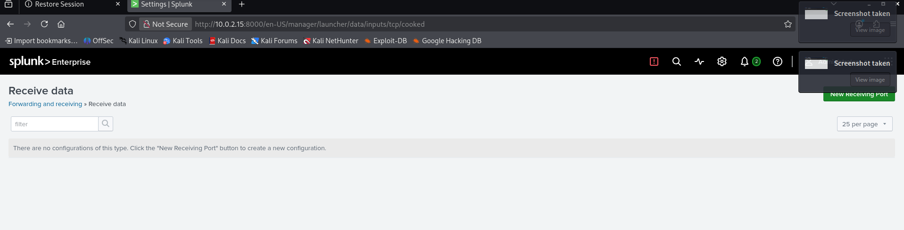
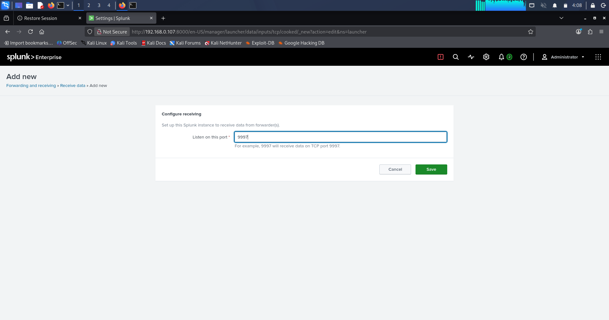

**Why do this before installing the UF:** the installer can then test against a live port, and the data has an endpoint immediately.

## 4. Create the `win` index (Kali)

Settings → Indexes → New Index → name `win`, type Events.

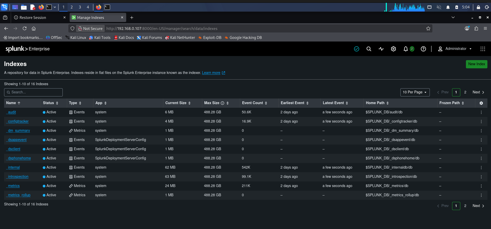
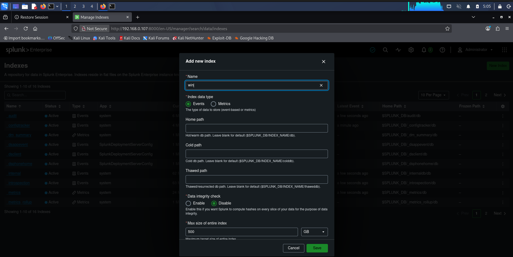
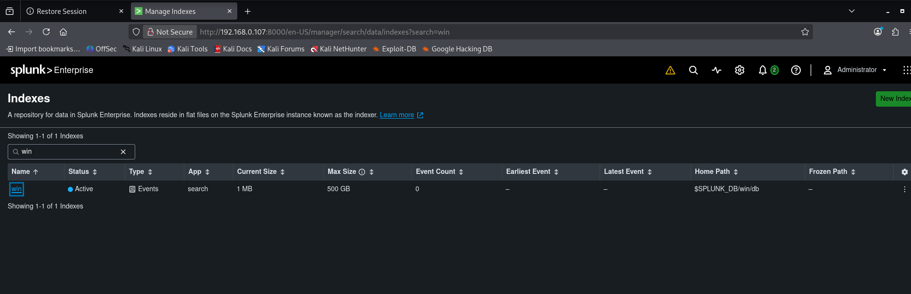

**Why a dedicated index:** separate retention, separate access control (roles can be limited to `index=win`), and faster searches than filtering inside `main`.

## 5. Install the Universal Forwarder (Windows 11)

Download the Windows `.msi` from splunk.com (login required), copy it to the VM, and run it.

1. Accept the licence, choose **on-premises Splunk Enterprise**.
2. Create a **local** admin username/password for the forwarder. They are used only for local CLI commands on this VM. Use a unique password, not one reused anywhere else.
3. **Deployment server:** leave blank (single forwarder).
4. **Receiving indexer:** enter the Kali IP and `9997`.
5. Install.

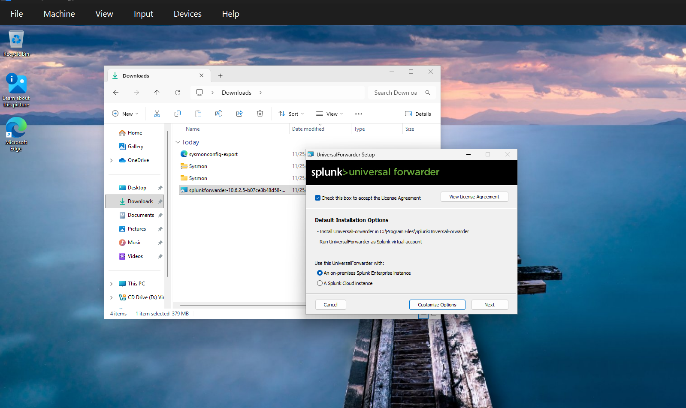
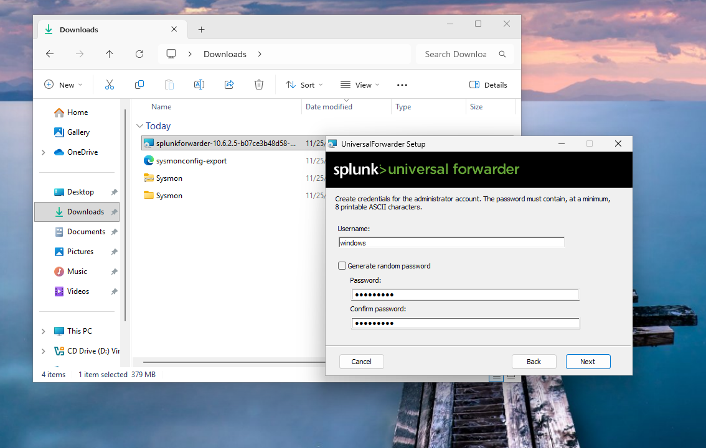
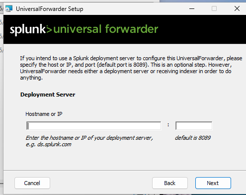
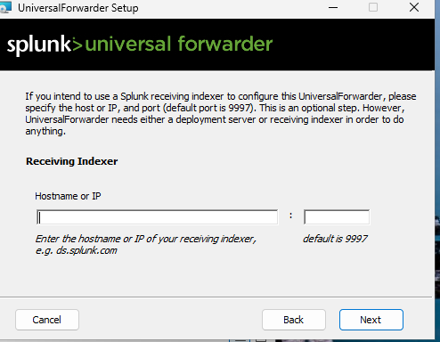
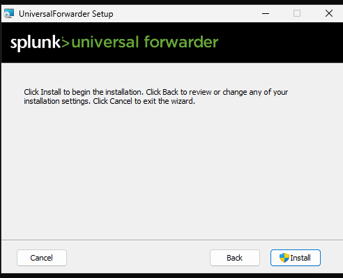

**Verify the forward target** (Administrator CMD):

```cmd
"C:\Program Files\SplunkUniversalForwarder\bin\splunk.exe" list forward-server
```

Expected: the Kali IP under **Active forwards**.

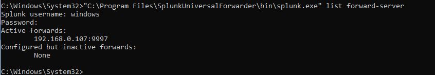

## 6. Tell the UF what to collect (`inputs.conf`)

Edit as Administrator: `C:\Program Files\SplunkUniversalForwarder\etc\system\local\inputs.conf`

```ini
[WinEventLog://Microsoft-Windows-Sysmon/Operational]
disabled = false
index = win
renderXml = true

[WinEventLog://Security]
disabled = false
index = win
```

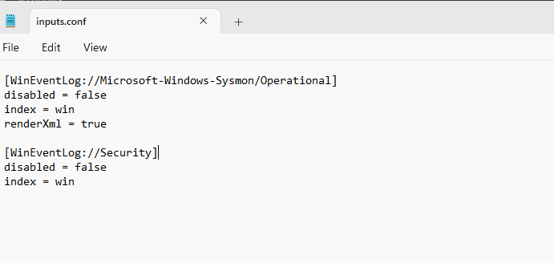

```cmd
"C:\Program Files\SplunkUniversalForwarder\bin\splunk.exe" restart
```

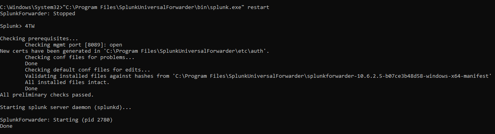

**Why each setting:**
- `[WinEventLog://<channel name>]` — the channel path must match the Event Viewer path exactly.
- `index = win` — without it, events go to the default index `main`.
- `renderXml = true` — sends the full XML event. Sysmon fields (`Image`, `CommandLine`, `Hashes`…) live in `<Data Name='...'>` elements, so XML keeps them intact. The sourcetype becomes `XmlWinEventLog`.
- Stanza names are case-sensitive and the file needs no BOM; use a plain-text editor.

## 7. Install the Splunk Add-on for Sysmon (Kali)

Apps → Find More Apps → search "Sysmon" → **Splunk Add-on for Sysmon** → Install (needs a splunk.com login) → restart if prompted. Permissions: **All apps (global)**.

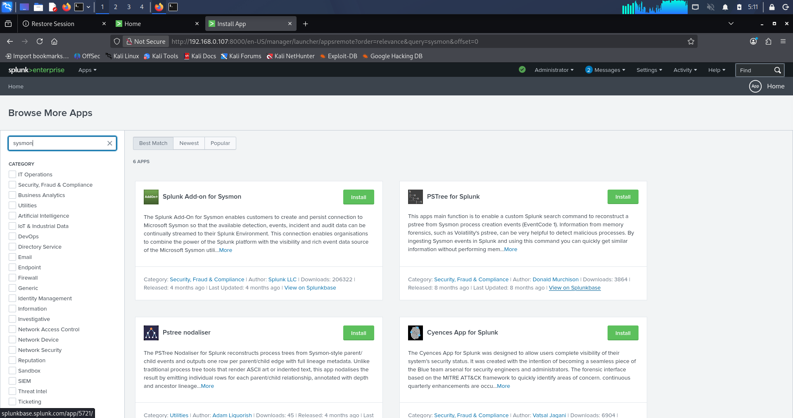

## 8. Troubleshooting log (what actually broke)

### 8.1 Security events arrived, Sysmon events did not

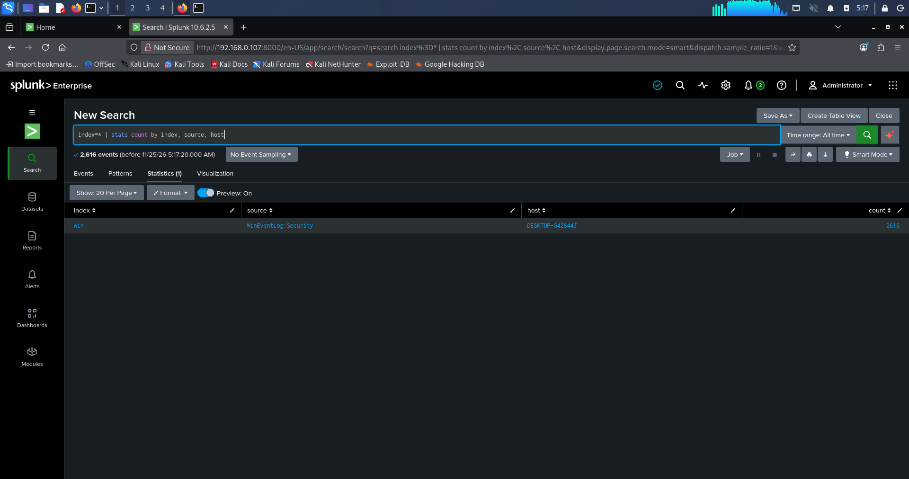

Diagnosis: `sc qc SplunkForwarder` showed `SERVICE_START_NAME : NT SERVICE\SplunkForwarder`.

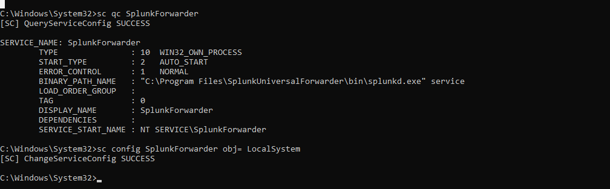

**Working fix `[checked]`:** run the service as LocalSystem, then restart.

```cmd
sc config SplunkForwarder obj= LocalSystem
"C:\Program Files\SplunkUniversalForwarder\bin\splunk.exe" restart
```

`obj=` needs a space after the equals sign.

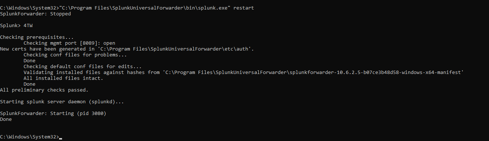
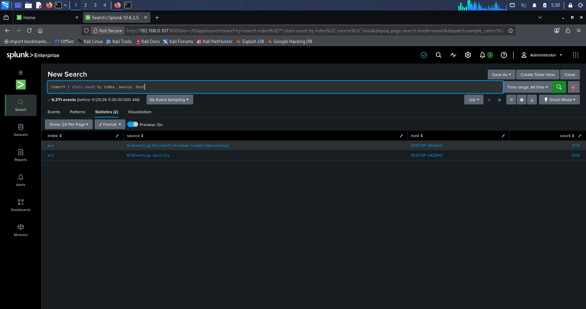

**Root cause `[verify]`:** the working assumption is that the default virtual account can read the Security log but not the Sysmon channel's access list. The fix worked, but I did not read the channel's security descriptor. Prove it with:

```cmd
wevtutil gl Microsoft-Windows-Sysmon/Operational
```

and look at `channelAccess`.

**Trade-off I must be able to defend:**
- Splunk's own docs say to avoid running the UF as Local System unless absolutely necessary, because a compromised forwarder then has full SYSTEM rights `[docs]`.
- Acceptable in an isolated lab. Not what I would recommend in production.
- **Least-privilege alternative to test `[verify]`:** keep the virtual account and grant it read access to only that channel by adding a read ACE for the Event Log Readers group (`S-1-5-32-573`) to the channel's `channelAccess`, then put the service account in that group. Splunk documents the Event Log Readers group for Security log access; I have not confirmed it covers the Sysmon channel in this build.

### 8.2 Events present, but no `EventCode` field

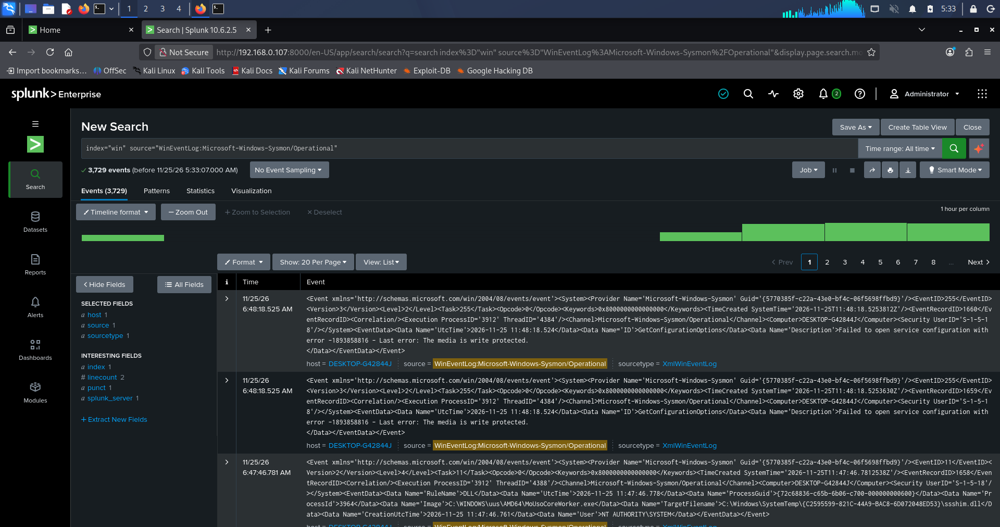

Interesting-fields sidebar showed only `index`, `linecount`, `punct`, `splunk_server`.

Steps taken: restart Splunk on Kali. On 10.2 and later, running as root needs the flag:

```bash
sudo /opt/splunk/bin/splunk restart --run-as-root
```

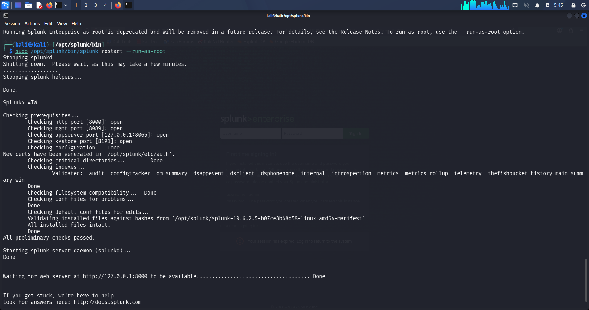

Quick test without any config change — `xmlkv` parses simple XML tags at search time. The tag is `<EventID>`, so the field is `EventID`, not `EventCode`:

```spl
index="win" source="WinEventLog:Microsoft-Windows-Sysmon/Operational" | xmlkv | stats count by EventID
```

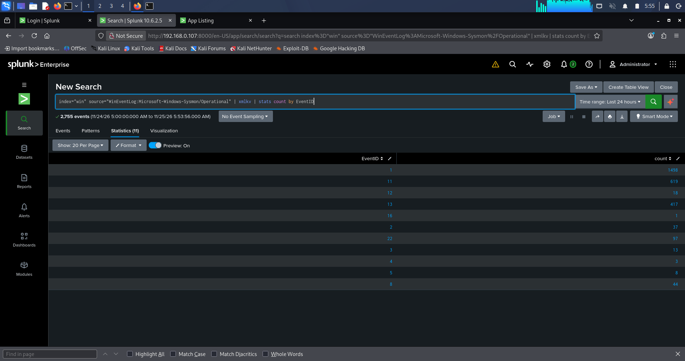

**Cause `[verify]`:** the add-on expects the sourcetype `XmlWinEventLog:Microsoft-Windows-Sysmon/Operational` while my events arrive as plain `XmlWinEventLog`, so the add-on's extractions did not match. `btool` output showed the add-on renaming the sourcetype to `XmlWinEventLog`.

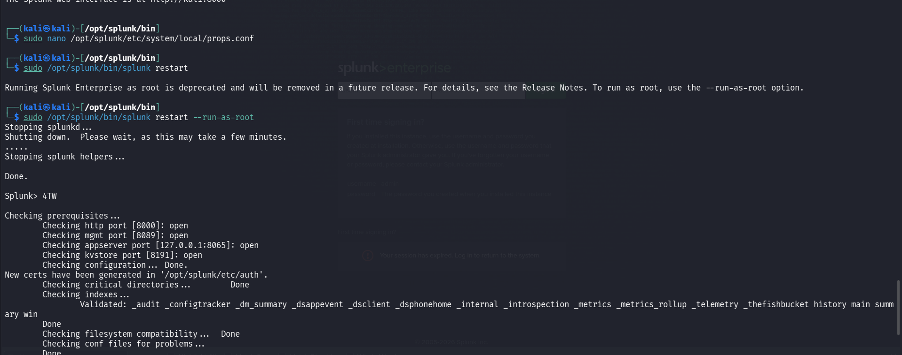

Check what is really applied:

```bash
/opt/splunk/bin/splunk btool props list XmlWinEventLog --debug
```

### 8.3 Final field extraction (Kali, search-time)

`/opt/splunk/etc/system/local/transforms.conf`

```ini
[sysmon_xml_data]
REGEX = <Data Name='([^']+)'>([^<]*)</Data>
FORMAT = $1::$2
MV_ADD = true
```

`/opt/splunk/etc/system/local/props.conf`

```ini
[XmlWinEventLog]
EXTRACT-sysmon_eventcode = <EventID>(?<EventCode>\d+)</EventID>
EXTRACT-sysmon_computer = <Computer>(?<Computer>[^<]+)</Computer>
REPORT-sysmon_xml_data = sysmon_xml_data
```

```bash
sudo /opt/splunk/bin/splunk restart --run-as-root
```

**Why this works:**
- `REPORT-` points to a transform; the transform's `REGEX` captures every `<Data Name='X'>value</Data>`, and `FORMAT = $1::$2` turns each into a field named X with the value.
- `MV_ADD = true` keeps repeated names as multi-value fields instead of overwriting.
- `EXTRACT-` pulls `EventCode` from `<EventID>` and `Computer` from `<Computer>`.
- The stanza is `[XmlWinEventLog]` because that is the sourcetype in the data, so it matches regardless of the add-on.
- Search-time config only needs to be on the search head (here the same Kali box). Existing events get the fields too, with no re-index.

**Known limits:**
- The regex requires single quotes (`Name='...'`), which is how the XML was rendered here. If the format changes, it silently extracts nothing.
- Values containing `<` are not an issue in valid XML, but XML-escaped entities (`&amp;`, `&lt;`) stay escaped in the field.
- The proper long-term route is to make the add-on's sourcetype match, not to maintain custom regex. Treat this as a lab fix.

### 8.4 Verify

```spl
index="win" source="WinEventLog:Microsoft-Windows-Sysmon/Operational"
| stats count by EventCode
```

```spl
index="win" source="WinEventLog:Microsoft-Windows-Sysmon/Operational" EventCode=1
| table _time, User, ParentImage, Image, CommandLine
```

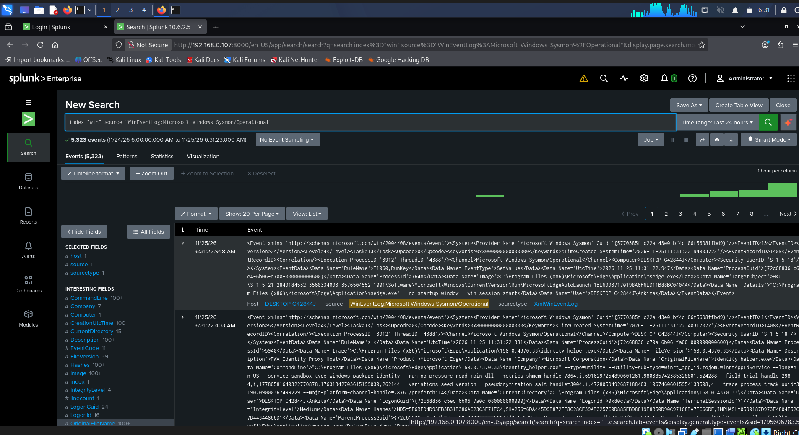
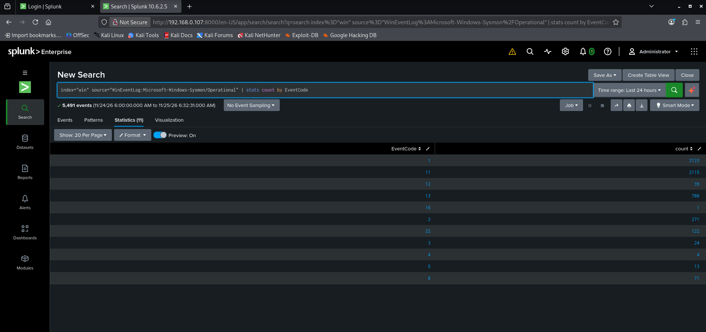

**Open item:** the earlier screenshot (sysmon-29) shows Sysmon events with EventID 255 ("Failed to open service configuration… The media is write protected"). EventID 255 is Sysmon's own error event `[docs]`. It does not appear in the final `stats` output. Check with `EventCode=255 | table _time Description` and confirm whether it was a one-time install-time error.

## Sysmon Event ID reference (seen in my data)

| EventCode | Name | Typical detection use |
|---|---|---|
| 1 | Process creation | Command-line and parent/child detection (e.g. Office spawning PowerShell) |
| 2 | File creation time changed | Timestomping |
| 3 | Network connection | C2 beaconing, unusual outbound processes |
| 4 | Sysmon service state change | Detect tampering/stop of Sysmon |
| 5 | Process terminated | Process lifetime |
| 8 | CreateRemoteThread | Process injection |
| 11 | File created | Dropped payloads |
| 12 / 13 | Registry object created/deleted · value set | Persistence (Run keys: seen as `T1060,RunKey` rule names) |
| 16 | Sysmon config state changed | Config tampering |
| 22 | DNS query | Domain-based hunting |
| 255 | Sysmon error | Health monitoring |

## Files changed

| Machine | File / component | Purpose |
|---|---|---|
| Windows 11 | `C:\Program Files\SplunkUniversalForwarder\etc\system\local\inputs.conf` | What to collect and which index to use |
| Windows 11 | `SplunkForwarder` service (LocalSystem) | Lets the UF read the Sysmon channel (lab-only trade-off) |
| Kali | `/opt/splunk/etc/system/local/props.conf` | `EventCode`, `Computer`, link to transform |
| Kali | `/opt/splunk/etc/system/local/transforms.conf` | Parse all `<Data Name='…'>` into fields |

## Hygiene checks

- Screenshots show the Windows username `Ankita`, hostname `DESKTOP-G42844J` and home-LAN addresses. No passwords are visible (the installer password field is masked). Keep this repo private.
- The UF installer password was entered on screen. Do not reuse it elsewhere.

## Interview talking points

1. **Why Sysmon over native Event ID 4688?** Sysmon gives hashes, parent process, network and DNS in one source, and is tunable via XML config.
2. **Why `renderXml`?** It preserves every Sysmon field, but it requires search-time parsing.
3. **Why did two VMs on NAT both get 10.0.2.15?** VirtualBox NAT is per-VM and isolated. Host-only plus NAT is the safer fix.
4. **Why is LocalSystem risky?** A compromised forwarder runs with full local privileges; Splunk recommends the least-privilege virtual account.
5. **Search-time vs index-time extraction?** Search-time is reversible and needs no re-ingest; index-time cannot be changed later for stored data.

## Next steps (feeds Day 4+)

- Re-do the network as host-only + NAT with a static IP.
- Test the least-privilege channel-ACL approach in section 8.1.
- Run a few safe atomic tests (e.g. `whoami`, `net user`, encoded PowerShell) and find them with `EventCode=1`.
- Write the first detection: encoded PowerShell → saved search, mapped to MITRE ATT&CK.
